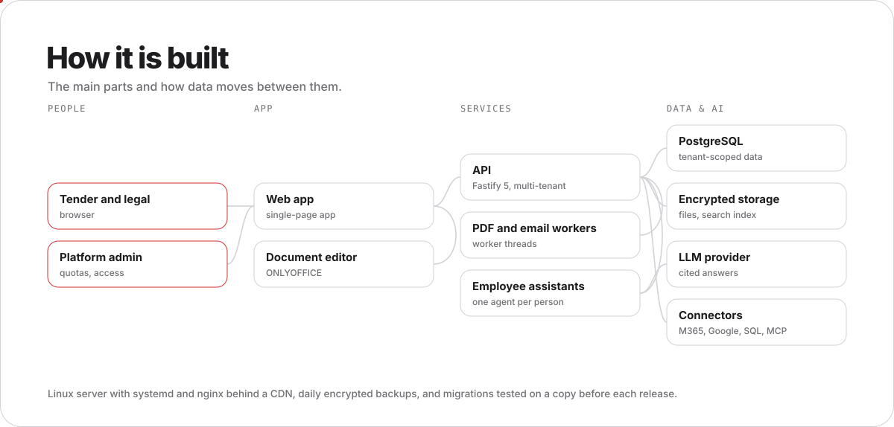
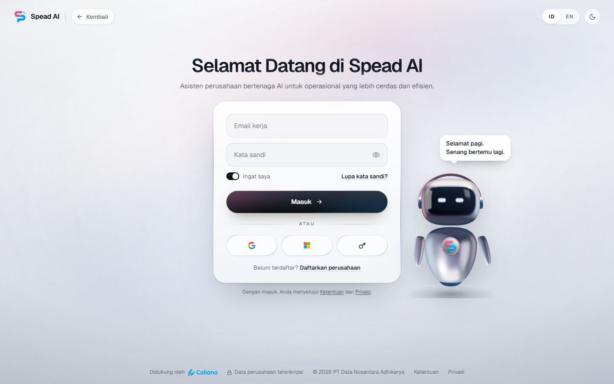

<!-- Showcase repository: the product is real and in use, its source code is private. -->

<a href="https://pro.spead.ai"><picture><source media="(prefers-color-scheme: dark)" srcset="assets/banner-dark.svg"></picture></a>

<a href="https://pro.spead.ai"><b>Open pro.spead.ai</b></a> · <a href="https://github.com/nugrahalabib">More of my work</a> · <a href="https://nugrahalabib.com">nugrahalabib.com</a> · <a href="mailto:nugrahalabib@gmail.com">Email</a>

## Overview

Spead AI Pro is the Spead AI deployment for the tender and contract/legal team of the EPCC Division at PT Wijaya Karya. It reads a tender package and fills the tender document review form (Lampiran 2.3). It also answers questions over the same package, with citations.

Filling that form by hand means reading long contract PDFs clause by clause. Here the AI proposes each answer, and every quote it uses is checked against the source document and given a status. People review and approve the result.

Around that core sits a full workspace: a knowledge library with access rights and confidentiality labels, Document Studio with an ONLYOFFICE editor, and connectors where any action that changes data waits for a human to approve.

| | |
| --- | --- |
| **Status** | Pilot at [pro.spead.ai](https://pro.spead.ai) |
| **Role** | Built and led by Nugraha Labib Mujaddid as Founder & Lead AI Engineer of Spead AI, deployed for the EPCC Division of PT Wijaya Karya. |
| **Period** | Since Oct 2026 |
| **Source** | Private. This repository presents the product; the code is not published. |

<picture><source media="(prefers-color-scheme: dark)" srcset="assets/features-dark.svg"></picture>

Features as text

- **Tender review form.** Fills the tender document review form (Lampiran 2.3) from the tender package. A person approves each item.
- **Verified quotes.** Each quote is checked against the source and marked as whole, proven, scattered, too short, partial or not found.
- **PDF and Office reading.** Reads PDF, Word, Excel and PowerPoint, runs OCR, and splits contracts into clauses, including A/B/C structured conditions.
- **Cited Q&A.** Ask questions over a tender package. Answers carry numbered source references you can open.
- **Knowledge library.** Documents carry access rights and confidentiality labels. One filter decides what each person's assistant may read.
- **Document Studio.** Letters, minutes, reports and presentations from templates, with locked letterhead, numbering and signatures, edited in ONLYOFFICE.
- **Connectors with approval.** Connects to Microsoft 365, Google, databases, REST and MCP. Actions that change data become approval requests.
- **SSO, 2FA and quotas.** Google sign-in, TOTP two-factor login, CSRF protection, rate limits, and usage quotas per company and per person.

<picture><source media="(prefers-color-scheme: dark)" srcset="assets/architecture-dark.svg"></picture>

<picture><source media="(prefers-color-scheme: dark)" srcset="assets/stack-dark.svg"></picture>

## Engineering highlights

- Every quote the AI cites is checked against the source text and gets one of six statuses before a person sees it.
- A single access filter decides what each person's assistant can read, so the AI sees only what that person may see.
- Agent tool calls are signed with HMAC-SHA256 and a one-time nonce, and run with the rights of the employee who owns the agent.
- Connector credentials sit in an AES-GCM vault, outbound traffic goes through an SSRF guard, and data-changing actions need human approval.
- On a synthetic test set of 16 documents and 45 queries, Recall@5 rose from 0.867 with keyword search to 0.933 with hybrid search and reranking.

## Screens

The Spead AI Pro sign-in page.

---

Built by [Nugraha Labib Mujaddid](https://github.com/nugrahalabib). This page describes a private codebase; questions about the product or a demo are welcome at [nugrahalabib@gmail.com](mailto:nugrahalabib@gmail.com).
